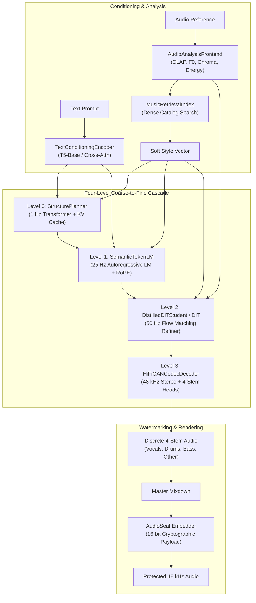

# AMADEUS Architecture

## Overview

AMADEUS is a real-time neural music generation and controllable zero-shot style transfer framework. It is structured as a hierarchical four-level coarse-to-fine generative cascade operating at progressively higher temporal resolutions: from 1 Hz structural outlines to 48 kHz stereo audio.



---

## The Four Generative Levels

### Level 0: Structure Planner (1 Hz)

The Structure Planner predicts macro-level musical form, tempo, key, section markers, energy trajectory, and chord progressions at a 1 Hz frame rate. Operating at this ultra-low frequency ensures global coherence over long horizons without context degradation.

- Model: Autoregressive Decoder-Only Transformer
- Target Rate: 1 frame per second (1 Hz)
- Structural Token Vocabulary:
  - Section Boundaries: Intro, Verse, Chorus, Bridge, Drop, Outro
  - Beat & Downbeat Tokens: 1/4, 2/4, 3/4, 4/4 metrics
  - Energy Levels: Quantized dynamic bands (0 to 7)
  - Key & Harmonic Mode: 24 major/minor keys
- FlashAttention: PyTorch `F.scaled_dot_product_attention`
- Caching: Static and dynamic Key-Value (KV) cache for fast autoregressive rollout

```python
from amadeus.models.planner.transformer import StructurePlanner
import torch

planner = StructurePlanner(
    vocab_size=1024,
    dim=512,
    depth=6,
    heads=8
)
cond = torch.randn(1, 512)
tokens = planner.generate(cond=cond, max_len=180)
```

---

## Level 1: Semantic Token Language Model (25 Hz)

The Semantic Token LM translates structural plans and text prompts into discrete acoustic semantic tokens across 4 residual vector quantizer (RVQ) codebooks using a causal transformer with a delay pattern.

- Target Rate: 25 frames per second (25 Hz)
- Codebook Layout: 4 codebooks with vocabulary size 2048 per codebook
- Interleaved Delay Pattern: Codebook $k$ is shifted by $k$ timesteps to preserve autoregressive dependency across quantizer tiers
- Conditioning:
  - Cross-attention to T5 text embeddings (768-dim)
  - Modulated adaptive layer normalization (AdaLN) for soft style embeddings (512-dim)
- Position Encoding: Rotary Position Embeddings (RoPE)
- Acceleration: Key-Value caching paired with vectorized Gumbel-Max sampling

```python
from amadeus.models.lm.transformer import SemanticTokenLM
import torch

lm = SemanticTokenLM(
    vocab_size=2048,
    num_codebooks=4,
    dim=1024,
    depth=12,
    heads=16
)
text_emb = torch.randn(1, 64, 768)
style_emb = torch.randn(1, 512)
tokens = lm.generate_fast(
    text_emb=text_emb,
    style_emb=style_emb,
    max_len=750
)
```

---

## Level 2: Latent Diffusion Refiner & Distilled DiT Student (50 Hz)

Level 2 maps discrete semantic tokens into continuous latent audio representations using a Diffusion Transformer (DiT) governed by Rectified Flow Matching. For low-latency execution, a 2-to-4 step Distilled Student DiT bypasses 50-step ODE trajectories.

### Rectified Flow Matching Formulation

The diffusion model learns a continuous vector field $v_\theta(x_t, t)$ that transports standard Gaussian noise $x_0 \sim \mathcal{N}(0, I)$ directly to the latent audio distribution $x_1 \sim p_{\text{data}}$ along straight trajectories:

$$x_t = (1 - t) x_0 + t x_1, \quad t \in [0, 1]$$

$$\frac{d x_t}{d t} = v_\theta(x_t, t)$$

The objective minimizes the optimal transport conditional flow matching loss:

$$\mathcal{L}_{\text{CFM}}(\theta) = \mathbb{E}_{t, x_0, x_1} \left[ \| v_\theta(x_t, t) - (x_1 - x_0) \|_2^2 \right]$$

### Distilled Student Inference

The distilled student model mimics the integrated flow field in 1 to 4 steps using an Euler midpoint solver with batched Classifier-Free Guidance (CFG) and dynamic variance rescaling:

$$\tilde{v}_t = v_\theta(x_t, \emptyset, t) + s \cdot (v_\theta(x_t, c, t) - v_\theta(x_t, \emptyset, t))$$

```python
from amadeus.models.dit.flow_matching import DiffusionTransformer, FlowMatchingScheduler
from amadeus.models.distill.student import DistilledDiTStudent
import torch

student = DistilledDiTStudent(
    latent_dim=128,
    dim=768,
    depth=12,
    heads=12
)
tokens = torch.randint(0, 2048, (1, 4, 300))
style = torch.randn(1, 512)
latents = student.sample(
    semantic_tokens=tokens,
    style_emb=style,
    steps=4,
    cfg_scale=3.5
)
```

---

## Level 3: Neural Audio Codec & Multi-Stem Synthesis (48 kHz Stereo)

The neural codec converts continuous latents into high-fidelity 48 kHz stereo audio.

- Encoder: SEANet architecture with multi-stage convolutional downsampling (strides [4, 5, 6, 8], total stride 960) and Snake activation functions:
  $$\text{Snake}(x) = x + \frac{1}{\alpha} \sin^2(\alpha x)$$
- Decoder: HiFi-GAN generator with transposed convolutions, multi-receptive field fusion (MRF), and four stem generation heads:
  1. `vocals`: Formant-preserving harmonic voice reproduction
  2. `drums`: Transient-accurate percussion reconstruction
  3. `bass`: Low-frequency phase-coherent sub-bass
  4. `other`: Polyphonic synthesizers, guitars, and environmental textures
- Discriminator: Multi-Period Discriminator (MPD) across periods [2, 3, 5, 7, 11] combined with Multi-Scale Complex STFT Discriminator (MS-STFTD)

```python
from amadeus.models.codec.decoder import HiFiGANCodecDecoder
import torch

decoder = HiFiGANCodecDecoder(
    latent_dim=128,
    upsample_rates=[8, 6, 5, 4],
    channels=512,
    stereo=True,
    stems=["vocals", "drums", "bass", "other"]
)
latents = torch.randn(1, 128, 150)
audio_stems = decoder(latents)
master_mix = sum(audio_stems.values())
```

---

## Conditioning and Acoustic Feature Extraction

The `AudioAnalysisFrontend` extracts multi-modal conditioning features from input audio references:

| Feature | Extraction Method | Dimension | Sample Rate |
| :--- | :--- | :--- | :--- |
| Semantic Timbre | CLAP / Audio Spectrogram Transformer | 512 | Global / Chunk |
| Fundamental Pitch ($F_0$) | Local Autocorrelation Normalized Peak Finder | 1 | 50 Hz |
| Harmonic Chroma | 12-bin Constant-Q / FFT Spectral Filterbank | 12 | 50 Hz |
| Dynamic Energy | Short-Time RMS Frame Energy | 1 | 50 Hz |

```python
from amadeus.data.analysis.frontend import AudioAnalysisFrontend
import torch

frontend = AudioAnalysisFrontend(sr=48000, hop_length=960)
raw_audio = torch.randn(1, 2, 48000 * 5)
features = frontend.analyze(raw_audio)
```

---

## Retrieval Index & Attribution Engine

AMADEUS features a native retrieval index and provenance tracking engine to credit musical influences:

1. A reference track's timbre embedding is matched against a catalog of licensed songs using normalized inner-product cosine search.
2. The nearest matching styles are combined into a soft-style blend vector:
   $$\mathbf{s} = \sum_{i=1}^k w_i \mathbf{e}_i, \quad w_i = \frac{\exp(\text{sim}(q, e_i) / \tau)}{\sum_j \exp(\text{sim}(q, e_j) / \tau)}$$
3. The generation pipeline logs the exact contribution weights of catalog references into an immutable attribution ledger.

```python
from amadeus.retrieval.index import MusicRetrievalIndex
from amadeus.retrieval.attribution import AttributionEngine
import torch

index = MusicRetrievalIndex(dim=512)
index.build_mock_catalog(num_tracks=100)
query = torch.randn(1, 512)
matches, soft_style = index.search(query, k=3)

engine = AttributionEngine()
record = engine.log_generation(
    job_id="job-001",
    matches=matches,
    prompt="synthwave arpeggio",
    duration_s=15.0
)
```

---

## Watermarking & Provenance

To safeguard synthetic audio and detect unauthorized generation, all audio rendered through the AMADEUS pipeline receives an imperceptible AudioSeal watermark:

- Carrier: State-space 16-bit cryptographic payload embedded in imperceptible frequency sub-bands
- Robustness: Survives MP3/AAC compression down to 64 kbps, Gaussian noise addition, clipping, and downsampling to 16 kHz
- Verification: Detection threshold $\tau \ge 0.85$ yielding $< 10^{-6}$ false alarm rate

```python
from amadeus.safety.watermark import AudioSealWatermarker
import torch

watermarker = AudioSealWatermarker()
audio = torch.randn(1, 2, 48000 * 10)
protected_audio = watermarker.embed(audio, payload=1337)
detected, payload = watermarker.detect(protected_audio)
```

---

## Tensor Dimension Flow

```
Input Audio:             [B, 2, T_samples]                  @ 48,000 Hz
Frontend Features:       [B, 15, T_frames] (F0 + Chroma)    @ 50 Hz
CLAP Embedding:          [B, 512]                           @ Global
T5 Text Embedding:       [B, L_text, 768]                   @ Text Tokens
Level 0 Plan:            [B, T_sec, 512]                    @ 1 Hz
Level 1 Semantics:       [B, 4, 25 * T_sec]                 @ 25 Hz
Level 2 Flow Latents:    [B, 128, 50 * T_sec]               @ 50 Hz
Level 3 Stems Waveform:  {stem: [B, 2, 48000 * T_sec]}      @ 48,000 Hz Stereo
```
