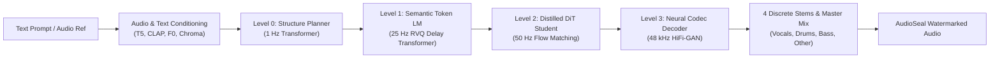

<div align="center">

# AMADEUS

**Real-Time Controllable Neural Music Generation & Style Transfer Framework**

[](LICENSE)
[](https://www.python.org/)
[](https://pytorch.org/)
[](#)
[](https://github.com/ak495867)

[Architecture](ARCHITECTURE.md) • [Usage Guide](USAGE.md) • [Model Card](docs/MODEL_CARD.md) • [Ethics & Safety](docs/ETHICS_AND_SAFETY.md) • [License](LICENSE)

</div>

---

## Highlights

AMADEUS is an open-source, production-grade neural music generation engine built for real-time performance, zero-shot style transfer, and discrete stem synthesis. It unifies coarse structural composition with high-fidelity acoustic audio generation through a four-level hierarchical cascade.

- **Four-Level Coarse-to-Fine Generative Cascade:** Progressive modeling from 1 Hz macro-structure planning, to 25 Hz semantic acoustic tokens, 50 Hz rectified flow latents, and 48 kHz stereo waveform synthesis.
- **Continuous Flow Matching & Distilled DiT Student:** High-fidelity timbre synthesis accelerated to 1–4 generation steps via optimal transport vector field distillation with batched Classifier-Free Guidance (CFG).
- **Zero-Shot Style Transfer:** Instant extraction and transfer of timbre, melodic pitch contours ($F_0$), harmonic chroma, and dynamic envelopes using an integrated `AudioAnalysisFrontend`.
- **Discrete 4-Stem Output:** End-to-end multi-track synthesis producing isolated `vocals`, `drums`, `bass`, and `other` stems natively alongside the master stereo mix.
- **Sub-100ms Latency Engine:** FlashAttention (`F.scaled_dot_product_attention`) and KV-caching across all autoregressive stages for live streaming and interactive DAW sessions.
- **Fair Music Attribution:** Retrieval index identifying musical influences and calculating soft-style provenance vectors to credit source catalogs.
- **Cryptographic Audio Watermarking:** Integrated `AudioSeal` state-space watermarker embedding a tamper-resistant 16-bit cryptographic payload.

---

## System Architecture



For complete mathematical formulations and layer diagrams, see [ARCHITECTURE.md](ARCHITECTURE.md).

---

## Quickstart

### Installation

```bash
git clone https://github.com/ak495867/AMADEUS.git
cd AMADEUS
pip install -e .
```

### Python API

```python
import torch
import soundfile as sf
from amadeus.pipeline.inference import AMADEUSPipeline

device = "cuda" if torch.cuda.is_available() else "cpu"
pipeline = AMADEUSPipeline(device=device, checkpoint_dir="./checkpoints")

result = pipeline.generate(
    text_prompt="cyberpunk dark synthwave with heavy analog bass and driving percussion",
    duration_s=15.0,
    style_strength=0.8
)

sf.write("synthwave_master.wav", result["audio"].squeeze(0).cpu().numpy().T, 48000)

for stem_name, stem_audio in result["stems"].items():
    sf.write(f"{stem_name}.wav", stem_audio.squeeze(0).cpu().numpy().T, 48000)
```

### CLI Multi-Stage Training

```bash
python scripts/train_full.py --dataset gtzan --epochs 5 --batch_size 4 --checkpoint_dir ./checkpoints
```

### Web API Serving

```bash
uvicorn serving.app:app --host 0.0.0.0 --port 8000
```

---

## Directory Layout

```
AMADEUS/
├── configs/               Config files for pipeline and training
├── data/
│   ├── analysis/          Audio frontend (CLAP, F0, Chroma, Energy)
│   └── dataset.py         Music dataset loaders (GTZAN, FMA)
├── docs/                  Datasheet, Ethics, Model Card
├── eval/                  Evaluation suite and audio metrics
├── models/
│   ├── codec/             SEANet encoder, HiFi-GAN decoder, discriminators
│   ├── distill/           Distilled student DiT for 1-4 step generation
│   ├── dit/               Diffusion transformer & flow matching scheduler
│   ├── lm/                Semantic token causal LM with RVQ delay
│   └── planner/           Structure planner autoregressive transformer
├── pipeline/              End-to-end inference orchestrator
├── plugin/                JUCE C++ DAW plugin bridge
├── retrieval/             Music index & attribution engine
├── safety/                AudioSeal cryptographic watermarker
├── scripts/               Training and execution scripts
├── sdk/                   Client SDK for streaming & DAW bridge
├── serving/               FastAPI REST & WebSocket server
├── ARCHITECTURE.md        Comprehensive architectural specification
├── LICENSE                MIT License (Copyright (c) 2026 ak495867)
├── README.md              Project overview and quickstart
├── setup.py               Package setup
└── USAGE.md               Full usage guide, API reference, and examples
```

---

## Benchmark Targets

| Benchmark Metric | Target | Evaluation Module |
| :--- | :--- | :--- |
| First-Chunk Latency | $< 100$ ms | `eval.metrics.EvaluationSuite` |
| Spectral Reconstruction (STFT) | $< 1.20$ | Multi-resolution STFT Distance |
| Style Cosine Similarity | $> 0.70$ | CLAP Embeddings Alignment |
| Fréchet Audio Distance (FAD) | $< 3.50$ | VGGish Distribution Distance |
| Beat Alignment (F1 Score) | $> 0.65$ | Dynamic Tempo & Beat Tracking |
| Watermark Detection Rate | $> 99.5\%$ | Bit Error Rate $< 10^{-4}$ |

---

## Documentation

- [ARCHITECTURE.md](ARCHITECTURE.md): Deep dive into cascade design, flow matching, and neural codec details.
- [USAGE.md](USAGE.md): Complete usage guide, training instructions, REST/WebSocket examples, and DAW bridge.
- [MODEL_CARD.md](docs/MODEL_CARD.md): Model specifications, training data, and intended use cases.
- [ETHICS_AND_SAFETY.md](docs/ETHICS_AND_SAFETY.md): Watermarking, fair attribution, and safety considerations.

---

## License

This project is licensed under the MIT License — see the [LICENSE](LICENSE) file for details.

Copyright (c) 2026 [ak495867](https://github.com/ak495867).
